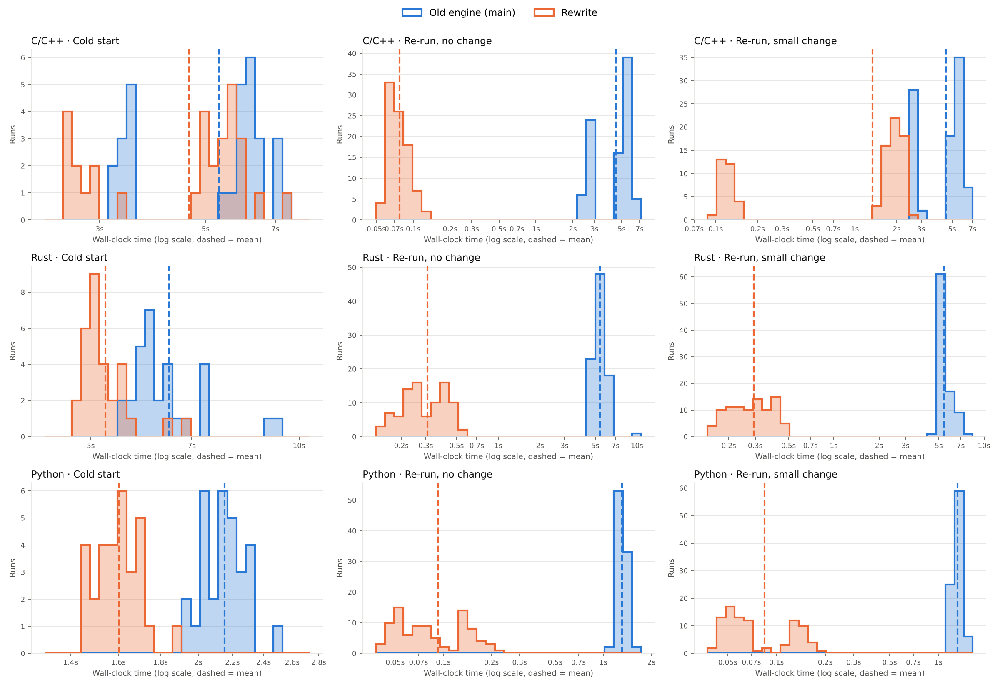

# tools/benchmarks/engines

Benchmarks the rewritten engine (this branch) against the old engine (`main`) on simple
C/C++, Rust and Python programs, in headless Chromium.

```bash
./mirror.sh                                   # download the toolchain assets (~200MB)
git worktree add ../engine-main origin/main   # build the old engine into ../engine-main/dist
(cd ../engine-main && npm ci && npm run build)
npm run build                                 # build this engine into dist/
node tools/benchmarks/engines/run.mjs         # from the repo root; appends to results/results.jsonl
python3 tools/benchmarks/engines/analyze.py   # histograms + results/summary.md
```

`run.mjs` takes `--contexts`, `--reps`, `--langs`, `--programs`, `--engines`, `--old`,
`--new` and `--mirror`.

## Method

The two engines have different interfaces, so `page/bench.js` puts both behind one
interface. It times the work a user would wait for, from the page's point of view
(`performance.now()` around the whole operation, with the program's output checked against
its expected stdout):

| Scenario                 | Old engine (`main`)                                     | Rewrite                                                  |
| ------------------------ | ------------------------------------------------------- | -------------------------------------------------------- |
| **Cold start**           | `import()`, `Engine.create(lang)`, set `fs`, `run()`    | `import()`, `Engine.create()`, `writeFile`, `run(lang)`  |
| **Re-run, no change**    | set `fs` to the same source, `run()` on the same engine | `writeFile` of the same source, `run(lang)`              |
| **Re-run, small change** | set `fs` with one string literal changed, `run()`       | `writeFile` with one string literal changed, `run(lang)` |

- **Fresh state for every cold start.** Each cold start runs in a new browser context, so
  the HTTP cache is empty and there are no in-memory caches. Each context then does 3 pairs
  of (no change, small change) re-runs on the same engine.
- **No network variance.** Both engines fetch their toolchains from the same URLs, and
  Chromium resolves those hosts (`--host-resolver-rules`) to a local HTTPS server that serves
  a byte-identical mirror. The mirror sends GitHub Pages' headers (CORS, `max-age=600`), so
  each engine's HTTP caching behaves as it does in production. Real cold starts also pay
  download time (about 200MB of assets), which affects both engines the same way and is left out here.
- **Same compiler flags.** Both engines invoke clang, rustc and wasm-ld with the same flags.
  The old engine runs with `debugger.enabled = false`, which is the rewrite's default.
  One known asymmetry: the rewrite always emits DWARF for C++ (`-debug-info-kind=standalone`),
  but the old engine only emits it when debugging, so the rewrite does strictly more C++
  work. This biases the comparison against the rewrite.
- **No ordering bias.** The engines alternate which goes first in each context.
- **Programs.** `programs.mjs` has `hello`, `fib` (recursion plus loop) and `containers`
  (structs, vectors and maps). The C++ `fib` and `containers` use `<iostream>`, so their
  compiles are heavy. The histograms pool all three programs, which is why some are multimodal.

Setup: 4 vCPU Linux container, Chromium from Playwright 1.63, both engines in a non-release
local build (`npm run build`, engine wasm inlined in the bundle). 10 contexts × 3 programs per
language: n = 30 cold starts and 90 re-runs per engine, language and scenario.

## Results



| Language | Scenario             | Old engine (mean ± sd) | Rewrite (mean ± sd) | Old median | Rewrite median | Speedup (mean) |
| -------- | -------------------- | ---------------------- | ------------------- | ---------- | -------------- | -------------- |
| C/C++    | Cold start           | 5.34s ± 1.45           | 4.62s ± 1.43        | 6.02s      | 5.09s          | **1.16×**      |
| C/C++    | Re-run, no change    | 4.49s ± 1.36           | 0.08s ± 0.02        | 5.05s      | 0.07s          | **57.9×**      |
| C/C++    | Re-run, small change | 4.50s ± 1.35           | 1.34s ± 0.89        | 5.09s      | 1.68s          | **3.36×**      |
| Rust     | Cold start           | 6.49s ± 0.91           | 5.25s ± 0.46        | 6.17s      | 5.09s          | **1.23×**      |
| Rust     | Re-run, no change    | 5.41s ± 0.67           | 0.31s ± 0.11        | 5.21s      | 0.27s          | **17.6×**      |
| Rust     | Re-run, small change | 5.41s ± 0.58           | 0.29s ± 0.09        | 5.19s      | 0.28s          | **18.4×**      |
| Python   | Cold start           | 2.15s ± 0.13           | 1.60s ± 0.10        | 2.16s      | 1.61s          | **1.34×**      |
| Python   | Re-run, no change    | 1.31s ± 0.09           | 0.09s ± 0.05        | 1.30s      | 0.07s          | **14.2×**      |
| Python   | Re-run, small change | 1.32s ± 0.08           | 0.08s ± 0.04        | 1.31s      | 0.06s          | **15.6×**      |

Per-program numbers are in [`results/summary.md`](results/summary.md), raw samples in
[`results/results.jsonl`](results/results.jsonl), and one histogram per language and scenario in
`results/hist-<lang>-<scenario>.png`. One of the 1260 runs failed and is excluded: an old-engine
Rust small-change run returned an `EngineError` with a `null` message.

### Reading the numbers

- **Cold start is 1.2–1.3× faster.** Both engines must download and compile the same
  toolchain modules, so neither can gain much here.
- **Re-runs are where the rewrite wins.** The old engine spawns a new worker for every
  `run()`. Each time, it re-fetches the toolchain (from the HTTP cache), re-compiles the
  WebAssembly modules and re-unpacks the sysroot. That fixed cost is about 2.5s for C++,
  about 5s for Rust (rustc plus LLVM for wasm-ld) and about 1.2s for Python, and it is paid
  even when nothing changed. The rewrite keeps compiled modules and sysroots in memory across
  runs. (This breakdown is inferred from the code, not separately measured.)
- **No-change C++ re-runs skip compilation entirely.** The rewrite caches object files, so
  only the link and run remain (about 80ms). Rust has no such cache yet: no-change and
  small-change re-runs cost the same, about 0.3s, almost all of it rustc.
- **Small C++ changes are bound by clang itself.** Compiling `<iostream>` takes about 1.7–2.2s
  of real clang work in either engine, which caps the speedup at about 2.7–2.9× for those
  programs, against 22× for the `printf` hello world.
